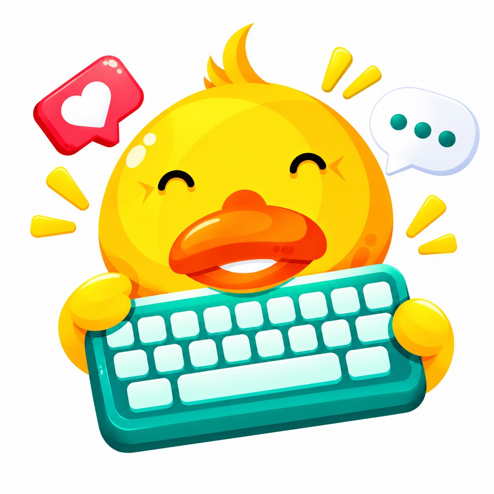
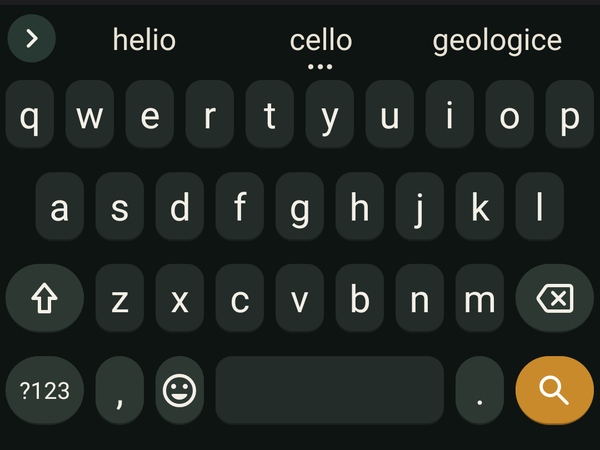
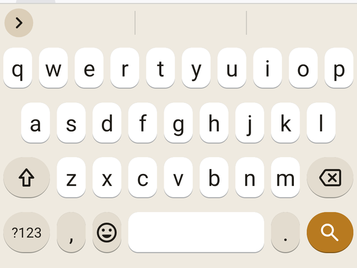
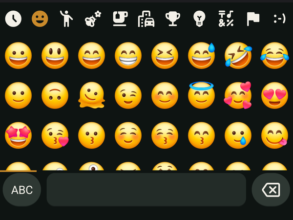
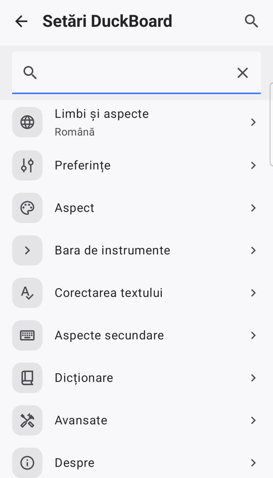

<div align="center">



<h1>DuckBoard</h1>

<p><strong>A quiet, privacy-first keyboard for Android.</strong></p>

<p>Gesture typing, suggestions and emoji — with no account, no analytics,<br />
and no <code>INTERNET</code> permission to leak anything through.</p>

<p>
<a href="https://github.com/cristifcp/DuckBoard/releases/latest"></a>
<a href="#install"></a>
<a href="https://kotlinlang.org"></a>
<a href="https://github.com/HeliBorg/HeliBoard"></a>
<a href="LICENSE"></a>
<a href="#privacy"></a>
</p>

<p><a href="#install">Install</a> · <a href="#screenshots">Screenshots</a> · <a href="#features">Features</a> · <a href="#build">Build</a> · <a href="#privacy">Privacy</a> · <a href="#status-and-limits">Status</a> · <a href="#license">License</a></p>

</div>

---

Most keyboards are built to collect. DuckBoard is built to type: a keyboard that
opens when you need it, suggests the word you were reaching for, and then gets
out of the way.

It is a fork of [HeliBoard](https://github.com/HeliBorg/HeliBoard), so the engine
is mature: glide typing, autocorrect, bundled dictionaries, multilingual
layouts, clipboard, emoji and one-handed mode all work from the first launch.
DuckBoard changes the identity and the out-of-box look — warm paper and deep
teal themes, filled rounded keys, a dedicated emoji key, and clipboard history
off until you ask for it.

There is no account, no feed, no analytics, no advertising, and no `INTERNET`
permission at all. Nothing you type can leave the device.

## Install

Download the signed APK from [Releases](https://github.com/cristifcp/DuckBoard/releases/latest),
open it on the phone, and allow the installer to install from that app once.
Android 5.0 (API 21) or newer.

<details>
<summary><b>Verify the signing certificate</b></summary>

```text
SHA-256: 69:AA:F7:D9:EB:A9:5A:83:20:01:66:74:D8:CF:E2:72:F2:00:B0:1C:78:68:6B:AC:F8:05:C7:B4:12:05:CC:EE
```

```bash
apksigner verify --print-certs DuckBoard.apk
```

</details>

Then:

1. **Settings → System → Languages & input → On-screen keyboard → Manage keyboards**
   and enable **DuckBoard**.
2. Go back and choose **DuckBoard** as the current keyboard.
3. Open any text field and type. Long-press a letter for accents; the emoji key
   is in the bottom row.

## Screenshots

| Duck Night | Duck Paper |
| :---: | :---: |
| <br /><sub><b>Duck Night</b><br />Deep teal keys, cream text, amber action key.</sub> | <br /><sub><b>Duck Paper</b><br />Warm paper, white keys, suggestions above.</sub> |
| <br /><sub><b>Emoji</b><br />Categories, recents, search — all local.</sub> | <br /><sub><b>Settings</b><br />Languages, appearance, typing and clipboard.</sub> |

## Features

**Typing**

- Glide typing with HeliBoard's gesture decoder and open gesture data.
- Suggestion strip, autocorrect, learned words and a personal dictionary.
- Bundled dictionaries and multilingual subtypes, including Romanian.
- Number row, long-press accents and symbols, one-handed, split and floating
  modes, plus key height, gap and padding controls.
- Text correction, double-space period, auto-capitalisation and backspace
  reverting the last autocorrect.

**The look**

- **Duck Night** and **Duck Paper** themes, built on Duck Reader's cream, teal
  and amber palette. Night is the dark default, Paper the light one.
- Rounded, filled keys by default instead of HeliBoard's transparent Material
  keys; key hints off; a dedicated emoji key in the bottom row.
- Custom colours, key borders, icon style and background image, all in Settings.

**Privacy**

- No `INTERNET` permission: the capability is absent from the manifest.
- Android cloud backup and device-to-device transfer are disabled.
- Clipboard history is **off by default**; turn it on in Clipboard settings when
  you want it, and incognito pauses it again.
- No account, analytics, ads or update checks. Updates come from Releases or
  [Obtainium](https://github.com/ImranR98/Obtainium).

## Build

You need JDK 17 or newer and the Android SDK with `compileSdk 37`.

```bash
git clone https://github.com/cristifcp/DuckBoard.git
cd DuckBoard

./gradlew assembleDebug
./gradlew assembleRelease
```

`assembleRelease` signs when `keystore.properties` exists at the repository root
(git-ignored) or the `RELEASE_STORE_FILE`, `RELEASE_STORE_PASSWORD`,
`RELEASE_KEY_ALIAS` and `RELEASE_KEY_PASSWORD` environment variables are set.
Without either it produces an unsigned APK, as upstream does.

The debug APK installs as **DuckBoard** too; do not install it over a release
build signed with a different key.

## Tests

```bash
./gradlew testDebugUnitTest
./gradlew lintDebug
```

## Privacy

DuckBoard has no network permission and no analytics. Learned words, user
dictionary entries, clipboard history and settings live in the app's private,
device-protected storage; Android backup and device transfer are excluded.

Contacts are used only by HeliBoard's optional contact dictionary. The
`READ_CONTACTS` permission is declared for that feature, and Android asks for it
at runtime only if you enable the contact dictionary. Decline it and everything
else still works.

A backup can be written manually from **Settings → Advanced → Backup**, and it
goes only where you point it. Uninstalling the app deletes its data, so keep a
backup if you rely on learned words.

## Status and limits

This is DuckBoard 1.0, based on HeliBoard 4.3-beta1. It is a daily-driver
keyboard, not a finished product. Known limits:

- Android only; there is no iOS or desktop version.
- No cloud sync, no online dictionary downloads, no network features of any
  kind. Dictionaries are the ones bundled with the APK.
- Clipboard history is deliberately off by default. Enable it in Clipboard
  settings if you want history; incognito still pauses it.
- No built-in update check. Use Releases or Obtainium.
- Layouts, dictionaries and gesture decoding come from HeliBoard; upstream bugs
  can appear here too.
- Not on Google Play. The signed APK is distributed through GitHub Releases.
- The source is a fork of HeliBoard, so parts of the UI still say “HeliBoard” in
  upstream documentation links; the app itself is DuckBoard.

## Documentation

- [MODIFICATIONS.md](MODIFICATIONS.md) — every deliberate change from HeliBoard.
- [CHANGELOG.md](CHANGELOG.md) — what changed, and when.
- [HeliBoard wiki](https://github.com/HeliBorg/HeliBoard/wiki) — upstream layout
  and gesture documentation that still applies.
- [Duck Reader](https://github.com/cristifcp/DuckReader) — the sibling project
  and the source of the duck, the palette and the privacy rule.

## License

[GNU General Public License v3.0](LICENSE). You may use, study, share and modify
this app; if you distribute it or a modified version, the source has to stay
open under the same license.

DuckBoard is based on [HeliBoard](https://github.com/HeliBorg/HeliBoard), which
is based on the AOSP keyboard. Each release page carries the source archive for
its own tag.

## Credits

- **HeliBoard** and its contributors — the keyboard engine, dictionaries,
  gesture typing, layouts and most of the behaviour.
- **The AOSP keyboard** — the original foundation HeliBoard grew from.
- **Duck Reader** — the duck artwork, the cream/teal/amber palette and the
  privacy-first framing.
- DuckBoard's own additions: the identity, Duck Night and Duck Paper themes,
  filled rounded keys, clipboard-off default, white-background icon and this
  README.
